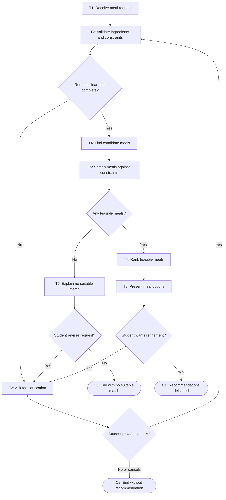

# Workflow of Tasks

## 1. Workflow Overview
### 1.1 Workflow Goal
This workflow supports the system goal defined in `my_first_agent/README.md`.

### 1.2 Workflow Trigger

One run starts when a student submits a request for a meal suggestion, including the ingredients they have available and any preferences or limits they want the system to consider. If the initial request does not include enough information to check dietary restrictions, available cooking time, or budget, the system asks the student for the missing details before searching for meals.

### 1.3 Completion Condition at Runtime

A run is complete when the system either presents one or more meal suggestions that meet the student's stated dietary, time, and budget constraints, or tells the student it cannot provide a suitable suggestion and explains why. A run also ends without a recommendation if the student declines to provide essential missing information or cancels the request.

### 1.4 General Workflow

The system receives the student's meal request and checks that the available ingredients and relevant constraints are clear enough to use. If required details are missing or ambiguous, it asks the student to clarify them and checks the updated request. Once the request is usable, the system finds candidate meals and screens out any that conflict with stated allergies or dietary restrictions, exceed the student's time or budget limits, or cannot be assessed against those limits. It then ranks the remaining feasible meals and presents suitable options with their instructions, which available ingredients they use, any required ingredients that are missing, and time or cost estimates when available.

If no feasible meal is found, the system explains the reason and asks whether the student wants to revise the request, such as by adding ingredients or changing a preference or limit. A revised request goes through validation and meal search again. If the student does not revise it, declines to clarify essential information, or cancels, the run ends without a recommendation. After receiving meal options, the student can ask to refine the request; otherwise, the system finishes the run with the recommendations delivered.

### 1.5 Workflow Diagram

