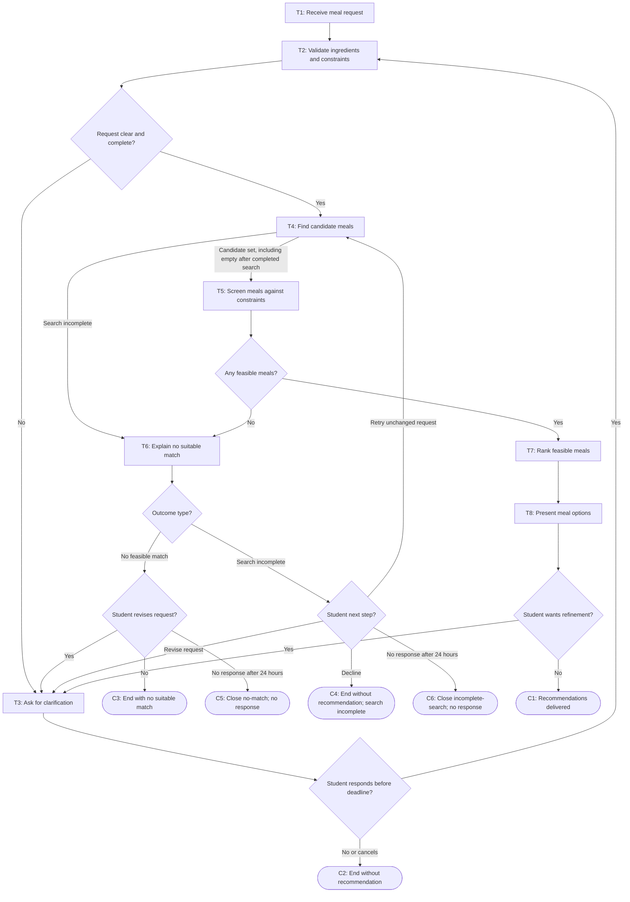

# Workflow of Tasks

## 1. Workflow Overview
### 1.1 Workflow Goal
This workflow supports the system goal defined in `my_first_agent/README.md`.

### 1.2 Workflow Trigger

One run starts when a student submits a meal request with available ingredients and explicit entries for allergies/dietary restrictions, time, and budget. An explicit entry may state a restriction/limit, “none,” “no limit,” or “unspecified”; the system does not infer a negative answer from a blank field. If any required entry is missing or ambiguous, the system asks the student to clarify it before searching for meals.

### 1.3 Completion Condition at Runtime

A run is complete when the system either presents one or more meal suggestions that pass screening against the student's stated constraints, explains that no candidate passed the completed screening, or reports that a search was incomplete without claiming that no suitable meal exists. A run also ends without a recommendation if the student declines to provide essential information, declines a search retry, or cancels.

### 1.4 General Workflow
The system receives the student's meal request and checks that available ingredients and explicit constraint declarations are clear enough to use. If required details are missing or ambiguous, T3 asks the student to clarify them and returns the updated request to T2. Once validated, T4 searches for candidate meals and sends its candidate set (including a valid empty set after successful searches) to T5. T5 screens each candidate against stated allergies and dietary restrictions, and applies fixed time and budget rules when those limits are stated and evidence is available. A candidate with a known conflict or a stated limit that cannot be assessed does not pass. If T4 cannot complete its search, T6 tells the student the search is incomplete; this is not represented as proof that no suitable meal exists. If T5 completes screening but no candidate passes, T6 explains the screening outcome. Otherwise, T7 ranks the passing meals and T8 presents them with available instructions, ingredient matches, missing ingredients, and supported time/cost details.

If no candidate passes screening, T6 explains the recorded reasons and asks whether the student wants to revise the request. If T4's search is incomplete, T6 explains that it cannot determine whether a suitable meal exists and offers a retry; an unchanged retry returns the same validated request to T4, while a changed request goes through T3 and T2. T6 allows 24 hours for the student's next-step choice after message delivery. A decline closes the run without a recommendation; no response also closes it without implying consent or treating silence as a choice. The student can also request refinement after T8 presents meal options; T3 captures the revision and T2 validates it before another search.

### 1.5 Workflow Diagram

